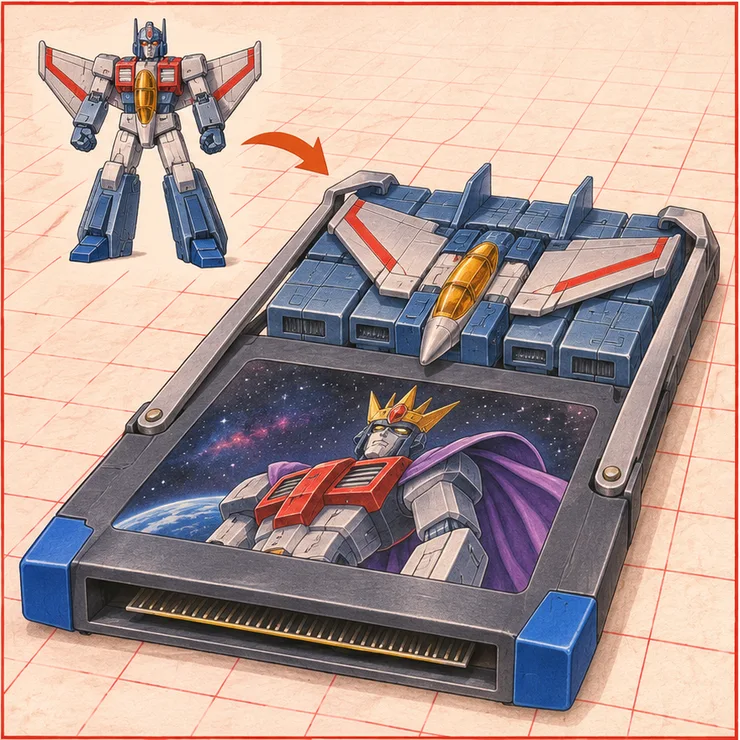
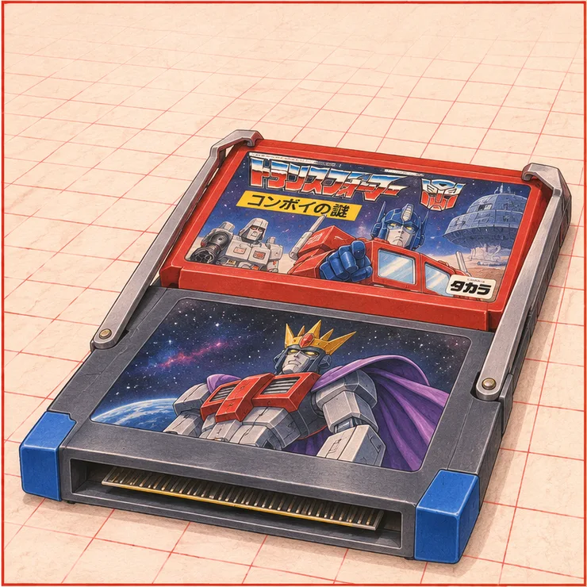

# Transformers: Megatron no Nazo

An unofficial Transformers fan-game project for the original front-loading NES. The project pairs a new Starscream campaign with a physical lock-on cartridge concept for the original Japanese Famicom game *Transformers: Mystery of Convoy*.

[Explore the interactive project site](https://mellgass.github.io/Megatron_No_Nazo/) for the illustrated ’80s commercial, jet and robot sprites, and the cartridge demo.

## Premise

Megatron hides Remote Control Circuit Linker cards from his TORQ III scheme inside copies of *Mystery of Convoy*. Beating the game would trigger his takeover of Earth’s electronics. The game is so hard that no one finishes it. Starscream offers to capture three satellites and broadcast an update to make it beatable. Soundwave assists over comms under Megatron’s orders, while Starscream has plans of his own.

## Gameplay

- Choose which satellite to attack first. In jet form, fight through a shoot ’em up approach to the airlock. Transform into robot form to brawl through the interior.
- Each capture grants one upgrade usable in both forms. The final capture unlocks King Starscream.
- With the original cartridge attached, the game opens in *Mystery of Convoy*. The first death launches the satellite campaign. After the third capture, return to the original game as King Starscream for an alternate finale.
- In standalone mode, start with the satellite campaign and reach a different ending.

## Cartridge concept

The proposed slim, Game Genie–style NES cartridge holds the original Famicom cartridge flat and flush in an inline socket. Low-profile spring arms grip its outer corners. For standalone play, the pack-in Transformer folds into a Famicom-shaped placeholder that fits the same socket.

| Standalone with folded Transformer | Lock-on with the original Famicom cartridge |
| --- | --- |
|  |  |

The game and cartridge are in development. Physical fit, connector engagement, and front-loader tray clearance still need verification.

## Website

This repository hosts the static project site. GitHub Pages publishes it from the root of `main`. For a local preview, open `index.html` with the `assets` folder alongside it. No build step is required.
